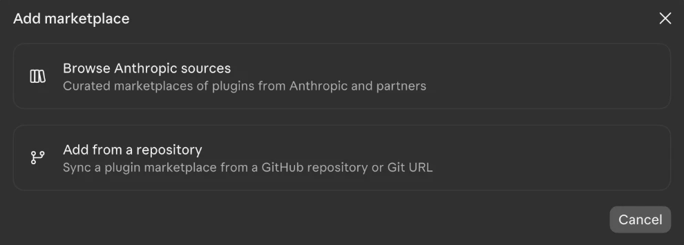

# Literature Review Writer – כותב סקירות ספרות

פלאגין ל־Claude Code שהופך תיקייה של מאמרים אקדמיים (PDF) לעבודה מלאה בפורמט Word: עבודה סמינריונית או מאמר סקירה, עם שער, תוכן עניינים, פרקים וביבליוגרפיה ב־APA.

*English summary at the end.*

---

## מה הוא עושה

1. **בודק את קובצי ה־PDF** – מחלץ את הטקסט ומזהה בעיות: קבצים סרוקים, עברית הפוכה, טבלאות ונוסחאות שנפגעו, מאמרים כפולים. בעיות קלות מתוקנות לבד; על השאר הוא שואל אותך מה לעשות.
2. **מראיין אותך** – סוג העבודה, שפה, אורך, שאלת המחקר (הוא מציע אפשרויות לפי המאמרים), פרטי השער.
3. **מתמצת כל מאמר** – וסוכן חזק יותר בודק כל תמצית מול המאמר.
4. ✋ **עוצר לאישור שלך** על התמציות.
5. **ממפה נושאים** – הסכמות, סתירות ופערי ידע בין המאמרים, ומציע תת־שאלות.
6. **בונה ראשי פרקים** – ✋ ועוצר לאישור שלך.
7. **כותב** פרק־פרק, ואז מחבר הכול לעבודה אחת.
8. **בודק עובדות** – כל טענה ומספר מול המקור.
9. **לולאת שיפור** – מבקר מחמיר נותן ציון לפי מחוון ומתקן מתקן רק את מה שצוין, עד 4 סבבים.
10. **בונה קובץ Word** ודוח קצר: מה לבדוק בעצמך.

הכותבים רצים על מודל חלש יותר מהבודקים, כך שכל עבודה נבדקת ע"י מודל חזק ממי שכתב אותה.

---

## מה צריך

- **מנוי Claude בתשלום** (Pro או Max). בלי מנוי אין Claude Code.
- **אפליקציית Claude למחשב** (Windows או Mac), עם לשונית Code. אפשר גם Claude Code בטרמינל.
- **Python 3.9 ומעלה.** בהרצה הראשונה הפלאגין בודק ומתקין לבד את הספריות שחסרות. אם אין Python בכלל, הוא יסביר איך להתקין (python.org ← Download; ב־Windows לסמן "Add python.exe to PATH").

> הערה על מודלים: הבודקים מוגדרים כ־Opus. אם המנוי שלך לא כולל Opus, הפלאגין עובר אוטומטית לסט קל יותר (בודקים על Sonnet, כותבים על Haiku) ומודיע לך.

---

## התקנה (פעם אחת)

### דרך א – באפליקציית Claude למחשב (הכי פשוט)
1. פותחים את אפליקציית Claude ועוברים ללשונית **Code**.
2. נכנסים להגדרות: לוחצים על גלגל השיניים ⚙️ ליד השם שלכם בפינה השמאלית התחתונה ← **Customize** ← **Plugins**.
   (קיצור דרך: מקלידים `/plugin` בתיבת ההודעה, וזה פותח את אותו מסך.)
3. בפינה הימנית העליונה לוחצים **+ Add**:

   

4. בוחרים **Add from a repository**:

   

5. מקלידים `Chaim-GurArie/lit-review` ומאשרים.
6. ברשימה מופיע **Literature Review Writer**. לוחצים **Add to this computer**:

   

7. סוגרים את ההגדרות. הפלאגין מותקן, ועכשיו עוברים ל[שימוש](#שימוש).

**עדכון לגרסה חדשה:** באותו מסך, תחת **Yours**, מוצאים את הפלאגין ומעדכנים.

### דרך ב – ב־Claude Code בטרמינל
בתיבת ההודעה מקלידים:

```
/plugin marketplace add Chaim-GurArie/lit-review
/plugin install lit-review@lit-review-marketplace
```

לעדכון לגרסה חדשה: `/plugin marketplace update lit-review-marketplace`.

### דרך ג – מקובץ zip
1. פותחים את ה־zip לתיקייה קבועה במחשב (למשל `Documents\lit-review`). לא למחוק אותה אחר כך.
2. בתוך Claude Code מקלידים, עם הנתיב לתיקייה:
   ```
   /plugin marketplace add C:\Users\<שם>\Documents\lit-review
   /plugin install lit-review@lit-review-marketplace
   ```
   (ב־Mac: `/plugin marketplace add ~/Documents/lit-review`)

אחרי ההתקנה ייתכן שתתבקשו להריץ `/reload-plugins` או לפתוח שיחה חדשה.

---

## שימוש

### לפני שמתחילים
יוצרים במחשב תיקייה חדשה (למשל `סמינר/מאמרים`) ומעתיקים אליה את כל מאמרי ה־PDF. רק את המאמרים, בלי קבצים אחרים.

### באפליקציית Claude, צעד אחר צעד
1. **פותחים שיחה חדשה בלשונית Code.** בתחתית המסך, ליד תיבת ההודעה, בוחרים את **התיקייה עם המאמרים** (לחיצה על שם התיקייה הנוכחית ← בחירת תיקייה).
2. **מפעילים את הפלאגין.** מקלידים `/lit-review:review` ולוחצים Enter. מספיק להקליד `/lit` והאפליקציה תשלים. אפשר גם לכתוב במילים: "תכתוב לי עבודה סמינריונית מהמאמרים בתיקייה".
3. **בדיקת הקבצים (כמה דקות).** הפלאגין מתקין לבד את מה שחסר, קורא את כל ה־PDF ומדווח, למשל: "17 תקינים, 2 דורשים תשומת לב". אם יש בעיה (קובץ סרוק, טבלה שנפגעה), הוא שואל מה לעשות.
4. **ריאיון קצר.** שאלות בבחירה מרובה: סוג העבודה, שפה, אורך, ושאלת המחקר (הוא מציע אפשרויות לפי המאמרים). בסוף הוא מבקש פרטים לעמוד השער. אפשר לדלג עליהם ולהשלים אחר כך.
5. ✋ **עצירה ראשונה: אישור התמציות.** מוצגת טבלה עם כל המאמרים, מידת הרלוונטיות שלהם ושורת תיאור. כאן אפשר להוציא מאמרים לא רלוונטיים.
6. **שאלות משנה.** הפלאגין מציע 2–4 שאלות משנה לפי מה שנמצא במאמרים. מאשרים או משנים.
7. ✋ **עצירה שנייה: אישור המבנה.** מוצגים ראשי הפרקים, הטיעון של כל פרק ומספר המילים. מאשרים או מבקשים שינויים.
8. **מכאן הכול רץ לבד:** כתיבה, בדיקת עובדות וסבבי שיפור. רואים בשיחה הודעות התקדמות קצרות, למשל "סבב 2: ממוצע 4.4". עבודה של 20 מאמרים לוקחת בערך שעה־שעתיים. אפשר לעזוב את המחשב, אבל לא לכבות אותו.
9. **בסוף** מקבלים הודעה עם מיקום קובץ ה־Word ושלושת הדברים החשובים ביותר לבדוק.

### אחרי שהעבודה מוכנה
- פותחים את התיקייה `review-output/final/`. שם נמצאים קובץ ה־Word והדוח `report.md`.
- כשפותחים את ה־Word הוא שואל אם לעדכן שדות. עונים **כן**, וכך נבנה תוכן העניינים.
- משלימים את המקומות המסומנים **XXX** (שיטת הסקירה, פרטי השער) ועוברים על הנקודות שבדוח.
- רוצים לשנות משהו? כותבים באותה שיחה, למשל "תקצר את פרק 3" או "עדכנתי את פרטי השער ב־project.yaml, תבנה את ה־Word מחדש".

**טיפ להפחתת חלונות אישור:** Claude Code מבקש אישור לפני יצירת קבצים. אפשר לבחור "אפשר לכל השיחה", או להחליף את מצב ההרשאות ל"אישור עריכות אוטומטי" (Accept edits). כל הקבצים נכתבים רק בתוך התיקייה `review-output`.

**אם משהו נעצר באמצע** (למשל נגמרה מכסת השימוש): פותחים שוב את אותה תיקייה ומקלידים שוב `/lit-review:review`. הוא ממשיך מאיפה שעצר.

---

## מה מקבלים

בתוך התיקייה נוצרת תיקייה `review-output`:

| מה | איפה |
|---|---|
| **העבודה בפורמט Word** | `review-output/final/<שם העבודה>.docx` |
| **דוח מה לבדוק** | `review-output/final/report.md` |
| דוח בדיקת ה־PDF | `review-output/02_pdf_check/report.md` |
| תמציות המאמרים | `review-output/03_summaries/` |
| מפת נושאים, ראשי פרקים | `review-output/05_matrix.md`, `06_outline.md` |
| כל הטיוטות, הבדיקות והציונים | `review-output/08_drafts/`, `09_fact_checks/`, `10_reviews/` |

כשפותחים את קובץ ה־Word, הוא שואל אם לעדכן שדות. עונים **כן** – כך נבנה תוכן העניינים.

מקורות שלא זוהו מסומנים בצהוב. נוסחאות מופיעות כטקסט (אפשר להמיר: לסמן ← הוספה ← משוואה).

---

## התאמה אישית

- **כללים לעבודה מסוימת:** בהרצה הראשונה נוצר בתיקייה קובץ `rules.md`. כותבים בו כללים (שורה שמתחילה ב־`-`) מתחת לכותרת המתאימה: כללי, כתיבה, ביקורת, מבנה. כללים לא יכולים לבטל את כללי הליבה (רק מקורות מהתיקייה, מקור לכל טענה, בלי מספרים ממוצאים).
- **הגדרות העבודה:** `review-output/project.yaml` – כותרת, אורך, פרטי שער, גופן ועוד.
- **מודל לכל סוכן:** ב־`project.yaml`, למשל `models: {section-writer: opus}`.
- **סוגי עבודות:** הפרופילים נמצאים ב־`skills/review/resources/profiles/`. כדי להוסיף סוג עבודה חדש, מעתיקים את `seminar.md` ומשנים.

---

## חשוב לדעת

- זו **טיוטה חזקה, לא עבודה גמורה.** צריך לקרוא הכול, לבדוק את הנקודות שבדוח ולהתאים לסגנון שלך.
- **יושרה אקדמית:** לרוב המוסדות יש מדיניות לגבי שימוש בבינה מלאכותית בעבודות, וחלקם דורשים גילוי נאות. בדקו מה הכללים בקורס שלכם.
- המאמרים נקראים ע"י Claude לצורך העבודה בלבד, לפי תנאי השימוש של המנוי שלכם.

---

## תרומה לפרויקט

הפרויקט פתוח, ותרומות יתקבלו בשמחה: תיקוני באגים, פרופילים לסוגי עבודות נוספים, תמיכה בשפות ושיפורים לסוכנים. כל שינוי נכנס דרך Pull Request ורק אחרי אישור של מנהל הפרויקט. ההסבר המלא נמצא ב־[CONTRIBUTING.md](CONTRIBUTING.md). מצאתם באג? פתחו [Issue](https://github.com/Chaim-GurArie/lit-review/issues).

---

## English summary

A Claude Code plugin that turns a folder of academic PDFs into a literature-review paper (seminar paper or journal review article) as a Word file with cover page, table of contents and APA 7 bibliography.

Pipeline: PDF extraction and quality check (scanned pages, reversed Hebrew, damaged tables, duplicates) → interview → per-article structured summaries, each verified by a stronger model → user checkpoint → cross-article theme matrix → outline → user checkpoint → chapter-by-chapter writing → integration → full fact-check → critic/reviser loop (rubric, up to 4 rounds) → best version built into .docx with a report of what to verify.

**Install (Claude desktop app, Code tab):** Settings → Customize → Plugins → **+ Add** → **Add from a repository** → `Chaim-GurArie/lit-review` → **Add to this computer**.
**Install (Claude Code in a terminal):** `/plugin marketplace add Chaim-GurArie/lit-review` then `/plugin install lit-review@lit-review-marketplace`.
**Use:** open the folder with the PDFs in Claude Code and run `/lit-review:review`.
**Contributing:** pull requests are welcome and are merged after maintainer review — see [CONTRIBUTING.md](CONTRIBUTING.md).
**Requires:** a paid Claude plan, Claude Code (desktop app or CLI), Python 3.9+ (packages `pdfplumber`, `python-docx`, `pyyaml` are installed automatically).
Project-specific rules go in `rules.md` in the project folder; settings in `review-output/project.yaml`. Writers run on lighter models than the agents that check them; if Opus is not available on the plan, the plugin falls back automatically.

License: MIT.
